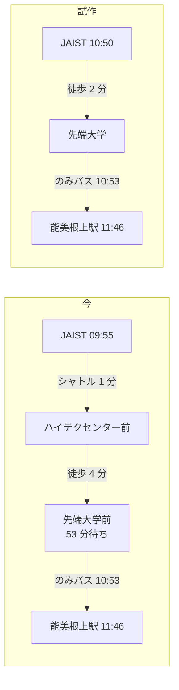

# のりかえアプリへの利用者の意見の検討（まとめ）

## 要約

:::message
**質問**：利用者から JAIST のりかえアプリ（主に経路検索ページ）への意見が 8 件届いた．どれを採用し，どう対応するか．

**結論**：53 分の待ちの原因は，設定の不足ではなく==探索の欠け==だった．出発地を JAIST のような停留所名で指定すると，探索は 164 m 先の隣の停留所（先端大学）へ歩いて乗る経路を探さない．この修正は歩く距離の上限（400 m 固定）を変えずに行える．ただし，離れた時刻の直通と比較して経路を除く既存の足切りも同時に修正する必要がある．
:::

- ② と ④ は経路検索ページへの追加だけで，これまでの決定に触れない．
- ①・⑤・⑥ はこれまでの決定（時刻欄を外す・メイン画面を変えない）に触れるため，ユーザーが決定する．
- ⑧ の Google マップの短縮リンクは静的ページでは展開できず，石川県全域の事前計算は不要である．

あなたの作業：採用する項目の決定（corabo の依頼欄）．

## 各意見にどう対応するか

| 番号 | 意見 | 推奨 | 見込み |
|---|---|---|---|
| ① | 時刻で絞り込む | 一覧は全件のまま「時刻へ移動」 | 0.5 日 |
| ② | 乗換の停留所で後の便を選ぶ | その停留所から再検索する | 1 日 |
| ③ | JAIST 周辺の徒歩 | 出発・到着から 400 m まで歩く | 1 日 |
| ④ | 現在地の近くのバス停 | 「現在地」ボタンを設ける | 0.5〜1 日 |
| ⑤ | 2 つのページの行き来 | 両方のページに記号のボタン | 0.25 日 |
| ⑥ | お気に入り | 条件を保存しメイン画面にも表示 | 1 日 |
| ⑦ | Tech サークルによるレビュー | ユーザーが決定する | ― |
| ⑧ | 地図のリンクから経路を出す | 長い URL の解釈と地図の任意の地点 | 1 日 |

見込みはエージェントの推察である．

## なぜ 53 分の待ちが出たか

探索は，出発地に指定した停留所から出る便だけから始まる．そのため JAIST からは，シャトルに 1 分乗り，4 分歩き，のみバスを 53 分待つ経路になる．出発地から 400 m 以内の停留所へ歩くことも許す試作では，2026-10-28 の時刻表で次の結果になった．

| 指標 | 今 | 試作 |
|---|---|---|
| JAIST→能美根上駅の最長の待ち | 53 分 | 3 分 |
| 良い経路が増える組 | ― | 399 組中 96 組 |
| 今の経路が消える組 | ― | 399 組中 29 組 |
| 1 日一覧の探索（Node） | 20.1 ms | 33.2 ms |

:::message alert
消える経路は既存の足切りによる．足切りは，乗換が少なく，乗換 1 回あたり 3 分以上短い経路が別にあると，その経路が何時間も後に出る場合でも元の経路を除く．今の公開版でも，標本 400 組中 87 組でこの除外が起きている．修正では，比較の相手を出発時刻の近い経路に限る．
:::

## Google マップのリンクは何が障害か

短縮リンク（`maps.app.goo.gl`）は CORS（Cross-Origin Resource Sharing）の許可の無い転送を返すため，GitHub Pages のページは転送先を読めない．公開の短縮リンク 30 件のうち 7 件は，転送先に地点の座標を含まなかった．地点を含む長い URL はページの中で読める．地図の中心だけを示す URL は，中心が別の場所でありうるため受け付けない．石川県全域の事前計算は効果が無い．難しいのは座標を得る部分であり，座標からの経路の計算は今でも約 50 ms で終わるためである．

## ユーザーが決定すること

| 番号 | 決定すること | 推奨 |
|---|---|---|
| ① | 時刻の扱い | 「時刻へ移動」 |
| ③ | 出発・到着の停留所からの徒歩 | 400 m まで（足切りの修正つき） |
| ⑤⑥ | メイン画面のボタンとお気に入り | 追加する |
| ⑦ | サークルでの共有の時期と方法 | ユーザーが決定する |
| ⑧ | 短縮リンクへの対応 | 長い URL と地図の地点 |

## 分からないこと

- スマホの実機での速さは測っていない．
- サーバー関数と Places API の費用は，利用回数の見込みが不明であるため検討していない．

## 関連

- 詳細文書: [user-feedback-2026-10.md](user-feedback-2026-10.md)
- 既存の設計: [route-search-plan.md](route-search-plan.md)
- 計測のスクリプト: [measure_feedback_2026_10.js](../tools/route/measure_feedback_2026_10.js)

<!-- md-translate: at=2026-10-27 chunks=6 claude=1 codex=1 sarashina=4 h=35d37d55 -->
